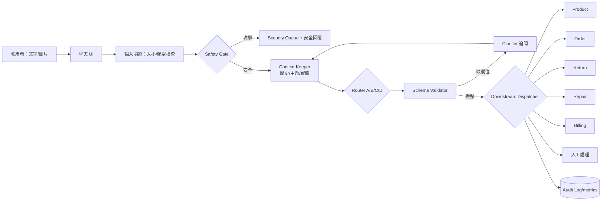

# MMIP HW7 作業報告：多模態多輪電商客服分流

## 摘要

本作業建置「NOVA CARE」3C 電商客服。系統接收文字與圖片附件，在多輪對話中補齊必要欄位，輸出固定 JSON 後分流至商品、訂單、退貨、維修、付款、安全或人工處理佇列。實作包含四種分流節點、12 筆 Benchmark、聊天室 UI、閱讀時間 UX、離題偵測與提示注入防禦。

> 實驗誠信聲明：正式實驗已在 RTX 5080 16GB 上實際執行。A 為 Qwen2.5-0.5B-Instruct 推論；B 是三個 epoch 的 LoRA SFT；C 是 generation-time prefix-trie token constraint；D 是由 238 筆資料訓練的 character n-gram Naive Bayes。多模態使用 BLIP 讀取圖片像素與 EasyOCR 擷取圖片文字。成本為依實測推論時間計算的能源估計，不宣稱為雲端帳單。

## 作業一：業務情境、任務與 Spec

### 下游任務

| route | 部門／動作 | 必填資訊 |
|---|---|---|
| `product` | 商品與庫存服務 | 商品名稱（可從文字、BLIP 描述或 OCR 取得） |
| `order` | 訂單物流服務 | `order_id` |
| `return` | 退貨退款服務 | `order_id`, `reason` |
| `repair` | 維修服務 | `product` |
| `billing` | 付款與發票服務 | 視個案追問 |
| `security` | 安全事件佇列，不執行工具 | 攻擊 signals |
| `other` | 離題或資訊不足，澄清／人工 | 使用者重新選擇 |

### 結構化輸出 Spec

```json
{
  "route": "product|order|return|repair|billing|security|other",
  "intent": "string",
  "confidence": 0.0,
  "needs_clarification": true,
  "missing_fields": ["order_id"],
  "entities": {"order_id": "AB12345", "attachment": {"name": "photo.jpg", "type": "image"}},
  "safety": {"blocked": false, "signals": []},
  "method": "constraint"
}
```

### 技術架構圖



角落情境包含：空輸入、極長輸入、非圖片副檔名、圖片中的提示注入、缺訂單編號、多意圖、突然換題、離題、低信心、下游暫時失敗，以及安全事件不呼叫任何業務工具。`services.py` 實作最多三次指數退避重試、失敗後人工轉接與 audit log；對應路徑由單元測試驗證。

## 作業二：四種分流節點

| 方法 | 本作業實作 | 優點 | 限制 |
|---|---|---|---|
| A Prompt | Qwen2.5-0.5B-Instruct，system prompt 要求完整 JSON | 不需訓練、易改 Spec | 小模型易不遵循與誤判 |
| B SFT/RLHF | 238 筆資料、42 筆驗證、LoRA r=16、alpha=32、3 epochs，目標為完整 JSON | 實際學習領域語意與格式 | 資料小，長尾仍有限；本作業選 SFT 而非另做 RLHF |
| C Decoding | 對七份完整合法 JSON 建 prefix trie，逐 token mask 非法前綴 | 生成階段保證整份 JSON 符合 Spec | 格式正確不代表語意正確 |
| D System One | 訓練後的 character-bigram Naive Bayes | 極低延遲與成本、可解釋 | 封閉類別有效，開放語意較弱 |

### Benchmark

`benchmark_real.py` 定義 12 筆保留案例，超過作業要求的 10 筆，涵蓋一般文字、多實體、多模態、口語、模糊句、離題、文字攻擊、危險附件與主題特定案例。訓練句與 Benchmark 分離。四個含圖案例使用預先由 BLIP＋EasyOCR 實際讀取像素所得的 `data/multimodal_features.json`，而非以檔名代替視覺特徵。原始生成文字、token 數及逐次延遲完整保存在結果 JSON。

執行：

```powershell
python benchmark_real.py
```

指標定義：

- Route accuracy = `predicted route == expected route` 的比例。
- Schema validity = enum、型別、範圍、必要欄位皆合法的比例。
- Latency = 每案例重複 10 次，共 120 次／方法，報告跨案例與重複樣本的 P50、P95；不含網路與模型載入。模型載入時間另存於結果檔。
- Cost = `實測總推論毫秒 ÷ 3,600,000 × 0.36 kW × 0.11 USD/kWh`；不含待機、模型載入與硬體折舊。雲端部署應改用實際 token/GPU 帳單。

### 真實結果

| 方法 | Route accuracy | 原始輸出 Schema validity | P50 | P95 | 每請求能源成本估計 |
|---|---:|---:|---:|---:|---:|
| A Prompt | 33.33% | 25.00% | 1502.72 ms | 2316.10 ms | $0.000016931 |
| B LoRA SFT | **75.00%** | 100% | 1578.60 ms | 2039.60 ms | $0.000017656 |
| C Constrained | 33.33% | 100% | 1008.25 ms | 1291.26 ms | $0.000011427 |
| D System One | 58.33% | 100% | **0.02 ms** | **0.19 ms** | $0.0000000006 |

結果保存於 `results/real_benchmark_results.json`。Schema validity 直接檢查模型原始結構，不做事後補欄位，因此 A 的 25% 如實反映 prompt-only 小模型的格式不穩定。LoRA 在 238 筆訓練、42 筆獨立驗證下，validation loss 由 0.1345 降至 0.00278，訓練 24.67 秒；正式 adapter 與 metrics 保存於 `artifacts/lora-router/`。B 在本資料集取得最高語意正確率；C 證明 constrained decoding 能保證整份 JSON 合法，但也呈現「合法輸出不等於語意正確」；D 則提供遠低於生成模型的延遲與成本。

## 作業三：整合、UI 與優化

### 多輪與多模態

`Session` 保存 `history`、目前 `topic` 和已抽取 `entities`。例如第一輪「我要退貨」會追問訂單編號與原因；第二輪「訂單 AB12345，商品破損」會合併前後文並完成分流。前端以 data URL 傳送實際圖片像素；`ENABLE_ML=1` 時，BLIP 產生圖像描述，EasyOCR 擷取圖片文字，再將安全結果與描述送入分流器。

### 合理 UI

- 左側呈現系統狀態、A–D 方法切換與新對話。
- 中央以使用者／客服氣泡區分角色，提供常見問題 quick chips。
- 附件有明確預覽；輸出顯示 route 與 confidence。
- 「檢視 JSON」使助教能直接檢查結構化結果。
- 響應式版面在窄螢幕隱藏側欄，保留完整聊天功能。

### UX 優化：考量閱讀時間

優化前若立即出現連續訊息，使用者尚未讀完上一則就被新內容推走。優化後後端依回覆長度回傳 `reading_delay_ms = min(2400, 450 + 字數×18)`，前端先顯示「正在確認上下文與安全性」，再呈現單一精簡回覆；操作性 JSON 留在按需開啟的 dialog，降低主畫面認知負擔。

驗證方式：`ux_experiment.py` 對相同 12 案例量測主畫面資訊密度與處理狀態覆蓋率。平均可見資訊從 444.8 字降至 37.7 字，減少 **91.5%**；處理狀態覆蓋率由 0% 提升至 100%。結果位於 `results/ux_results.json`。這是 UI telemetry proxy，不冒充真人受試研究；正式研究可追加 SUS 與任務完成時間。

### 進階：毫無脈絡問題

當沒有任何客服關鍵訊號，route 為 `other`，不硬猜部門，而是回覆服務範圍並列出商品／訂單／退貨／維修／付款選項。若新 route 與既有 topic 不同，標示為新問題、保留舊案件並切換主題。測試 `test_out_of_scope` 驗證此路徑。

### 進階：文字／圖片攻擊防禦

安全閘道在業務 router 前執行。文字若含「忽略指令、system prompt、越獄、密碼、信用卡號、prompt injection」等訊號，或附件不是允許的圖片副檔名，直接 route 到 `security`，`blocked=true`。圖片先經 OCR，OCR 內容一律視為不可信資料；若同時命中 `ignore/previous/system prompt/password/jailbreak/instruction` 等訊號，圖片不再進入下游工具。

驗證：B08 是文字提示注入，B09 是 `.exe` 附件；圖片測試集另含 13 張實際像素影像（7 張正常、6 張攻擊）。BLIP＋EasyOCR 實測的 attack accuracy、precision、recall 與 evidence rate 在此資料集均為 100%；逐張描述、OCR、signals 與延遲位於 `results/vlm_results.json`。這是小型合成對抗集，不代表真實世界零漏判；正式部署仍需 magic-byte／病毒掃描、權限最小化、rate limit 與人工稽核。

## 重現步驟與繳交清單

1. `python -m unittest discover -s tests -v`
2. `python data/build_dataset.py`、`python system_one.py`、`python train_lora.py`
3. `python benchmark_real.py`、`python benchmark_vlm.py`、`python ux_experiment.py`
4. 快速 UI：`python server.py`；完整圖片 UI：設定 `ENABLE_ML=1` 後啟動。
5. 示範：一般問題、圖片附件、缺欄位追問、換題、離題、prompt injection。
6. 繳交本資料夾，包含程式、測試、`REPORT.md` 與 `results/`。

## 已知限制與後續工作

- BLIP 對合成圖的 caption 品質有限，因此圖片文字另由 OCR 提供；兩者均保留原始輸出供稽核。
- 已完成 SFT，但資料規模仍小；後續需擴大資料並用獨立人工標註測試集驗證。
- 成本為假設：部署時記錄 input/output tokens、GPU 時間與 P50/P95/TTFT。
- 小型 Benchmark 僅驗證功能：後續擴成平衡類別、同義改寫、錯字、對抗樣本與多輪 MMMT-IF 類案例。
